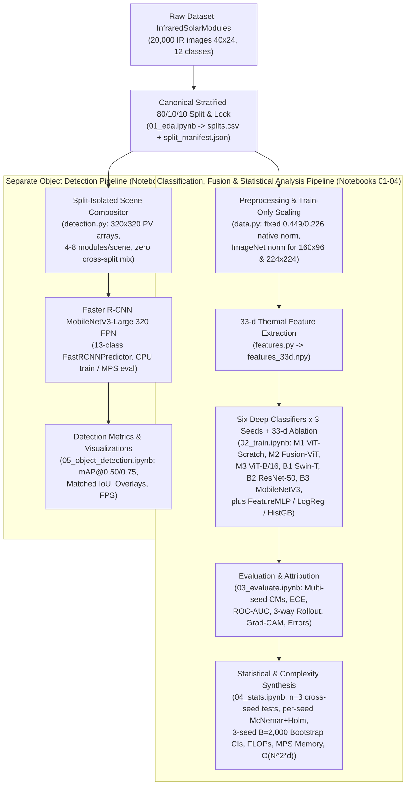

# Infrared Solar Module Fault Classifier — Capstone Project

**Course:** Computer Vision and Multimodal Machine Learning (40% Capstone)  
**Dataset:** `InfraredSolarModules` (20,000 grayscale IR crops, `40×24` px, 12 fault classes)  
**Primary Metric:** Macro-F1 (57:1 class imbalance: 10,000 `No-Anomaly` vs. 175 `Diode-Multi`)

---

## 1. Project Overview & Scope

This project classifies 12 photovoltaic (PV) module fault categories from UAV infrared thermography crops (`40×24` px single-channel grayscale). We implement a from-scratch Vision Transformer (`ViT-Scratch`, **M1**), a custom gated **image-derived feature-fusion** architecture (`Fusion-ViT`, **M2**) combining raw IR patch tokens with 33 engineered radiometric/gradient/texture features, and four ImageNet-pretrained benchmarks (**M3** `ViT-B/16`, **B1** `Swin-T`, **B2** `ResNet-50`, **B3** `MobileNetV3-Large`) across **3 random seeds (`0, 1, 2`)**, plus a separate simulated multi-module CNN object detection pipeline (`Faster R-CNN`, **D1**).

**Explicit Scope Clarifications:**
- **Simulated Multi-Module Object Detection (CLO3):** `InfraredSolarModules` provides image-level labels only (`module_metadata.json`). Rather than fabricating bounding boxes on single crops, [notebooks/05_object_detection.ipynb](notebooks/05_object_detection.ipynb) and [modules/detection.py](modules/detection.py) composite `320×320` multi-module PV array scenes strictly within each canonical split (`train`/`val`/`test`), fine-tuning `Faster R-CNN MobileNetV3-Large 320 FPN` (`18,986,604` params; `35.34% mAP@0.50`, `35.26% mAP@0.75`, `0.932` mean matched IoU, `49.3 FPS` MPS on `200` unseen test scenes) alongside classification + post-hoc spatial attribution (Attention Rollout & Grad-CAM).
- **Image-Derived Feature Fusion:** The 33-dimensional thermal feature vector is computed directly from the same `40×24` IR image (`modules/features.py`), so `Fusion-ViT` represents *image-derived feature fusion* rather than independent multi-sensor fusion.

---

## 2. Project Architecture Diagram



---

## 3. Folder Structure

```text
Capstone Project/
├── modules/
│   ├── data.py                   # Metadata loader, stratified 80/10/10 split, DataLoaders & manifest lock
│   ├── detection.py              # Split-isolated multi-module composite dataset, Faster R-CNN & AP evaluator
│   ├── features.py               # 33-dim handcrafted thermal feature extractor (O(H·W))
│   ├── models.py                 # ViTScratch (hand-written MHSA), FusionViT, FeatureMLP, pretrained wrappers
│   └── vit_fast.py               # Cached-token partial fine-tuning (160×96, N=61) + attention rollout helpers
├── notebooks/
│   ├── 01_eda.ipynb              # Stage 1: EDA, split creation, 33-d features, duplicate/leakage audit
│   ├── 02_train.ipynb            # Stage 2: 6 deep models × 3 seeds + 33-d Feature-Only ablation
│   ├── 03_evaluate.ipynb         # Stage 3: Multi-seed tables, CMs, ECE/ROC-AUC, Rollout, Grad-CAM, error analysis
│   ├── 04_stats.ipynb            # Stage 4: McNemar+Holm, B=2,000 bootstrap CIs, FLOPs, MPS memory, O(N²·d) scaling
│   └── 05_object_detection.ipynb # Stage 5: Simulated multi-module PV array Faster R-CNN training & mAP evaluation
├── outputs/
│   ├── splits.csv                # Canonical stratified 80/10/10 split (seed=42)
│   ├── split_manifest.json       # SHA-256 split/feature provenance & preprocessing lock
│   ├── features_33d.npy          # Precomputed (20000, 33) float32 feature matrix
│   ├── figures/                  # Detection visualisations (fig_detection_*.png)
│   └── results/
│       ├── eda/                  # 8 EDA visualisations
│       ├── data_integrity/       # SHA-256, pixel-similarity & leakage sensitivity CSVs
│       ├── metrics/              # 18 per-run JSONs + multiseed_summary.csv
│       ├── predictions/          # 18 test preds/probs .npy + test_targets.npy
│       ├── checkpoints/          # 18 best val Macro-F1 checkpoints (.pt)
│       ├── training_curves/      # 36 per-run epoch history CSVs & PNGs
│       ├── ablation/             # Feature-only MLP/LogReg/HistGB ablation outputs
│       ├── eval/                 # Evaluation CSVs & high-DPI PNG figures
│       ├── stats/                # Statistical tests, bootstrap CIs, complexity & scaling outputs
│       ├── detection/            # Faster R-CNN checkpoint, history, per-class AP CSV & summary JSON
│       └── provenance_manifest.csv # Per-checkpoint SHA-256, split_version & parameter map
├── docs/
│   └── requirements.txt          # Minimum verified Python package versions
├── data/
│   └── InfraredSolarModules/     # Raw dataset (module_metadata.json + images/*.jpg)
└── README.md
```

---

## 4. Master Execution Guide & Installation Troubleshooting

> **Working Directory:** All notebooks use relative paths (`../modules`, `../outputs`, `../data`) and must be executed from the `notebooks/` directory (or via Jupyter rooted in `notebooks/`).

1. **Environment Setup (Python 3.12 recommended):**
   ```bash
   python3.12 -m venv .venv
   source .venv/bin/activate        # Windows: .venv\Scripts\activate
   pip install -r docs/requirements.txt
   python -m ipykernel install --user --name capstone --display-name "Capstone (3.12)"
   ```
2. **Dataset Placement:** Place `InfraredSolarModules/` (containing `module_metadata.json` and `images/*.jpg`) inside `data/InfraredSolarModules/`.
3. **Run Sequence:**
   - **`01_eda.ipynb` (~1–2 min):** Generates splits, 33-d features, EDA figures, and the cross-split duplicate audit.
   - **`02_train.ipynb` (~3–5 h full training on Apple MPS; `<20 s` with `SKIP_EXISTING = True`):** Trains `M1–M3` and `B1–B3` across Seeds `0, 1, 2` plus 33-d Feature-Only ablations.
   - **`03_evaluate.ipynb` (~25 s):** Aggregates 3-seed metrics, confusion matrices, ECE, ROC-AUC, Attention Rollout, Grad-CAM, and failure cases.
   - **`04_stats.ipynb` (~90 s):** Cross-seed tests (`n=3`), per-seed McNemar + Holm-Bonferroni, 3-seed `B=2,000` bootstrap CIs, CPU `FlopCounterMode` MFLOPs, synchronized MPS latency/hook-based memory, and $O(N^2\cdot d)$ scaling.
   - **`05_object_detection.ipynb` (~4 min CPU training; `~15 s` with `skip_existing = True`):** Fine-tunes `Faster R-CNN` on split-isolated `320×320` scenes and evaluates test `mAP@0.50` / `mAP@0.75`.

Headless execution from repo root:
```bash
cd notebooks
for nb in 01_eda.ipynb 02_train.ipynb 03_evaluate.ipynb 04_stats.ipynb 05_object_detection.ipynb; do
  ../.venv/bin/jupyter nbconvert --to notebook --execute --inplace "$nb"
done
```

### Installation & Environment Troubleshooting
- **Apple Silicon (`MPS`) & Automatic `CPU` Fallback:**
  - `02_train.ipynb`, `03_evaluate.ipynb`, and `04_stats.ipynb` auto-select `mps` when `torch.backends.mps.is_available()` is true and fall back cleanly to `cuda` or `cpu`. Note that MPS memory/latency sections in `04_stats.ipynb` use `torch.mps.current_allocated_memory()` when `DEVICE == 'mps'` (on CPU-only machines, latency still runs while MPS allocation hooks report `0 MB` cleanly).
  - **`05_object_detection.ipynb` intentionally trains on CPU and evaluates on MPS/CPU:** On Apple Silicon, Faster R-CNN backward passes trigger slow host-device fallbacks for `ROIAlign`/NMS (`~8.4 s/step` at `bs=4` on MPS vs `~0.53 s/step` on CPU), whereas CPU training takes `~30 s/epoch` and MPS inference runs at `~49.3 FPS`.
  - If an MPS kernel error occurs during `Swin-T` batch scaling on memory-constrained Macs, keep the `bs=64` cap already configured in `04_stats.ipynb` (`bs=128` triggers unified-memory swapping).
- **Python Version Compatibility:** The project was developed and verified on **Python 3.12** with PyTorch `2.15.0`, Torchvision `0.29+`, NumPy `2.5+`, Pandas `3.1+`, and Matplotlib `3.11+` (`docs/requirements.txt`). Avoid global `pip install`; always install inside `.venv`. Note that older Matplotlib `<3.9` environments lack `boxplot(..., tick_labels=..., orientation='vertical')` used in `04_stats.ipynb` (`labels=` was deprecated in 3.9).
- **Pretrained Weights & Offline Runs:** `M3`, `B1–B3`, and `D1` download ImageNet/COCO weights into `~/.cache/torch/hub/checkpoints/` on first use. Ensure internet access on initial setup; if running offline later, keep `SKIP_EXISTING = True` (`02_train.ipynb`) / `skip_existing = True` (`05_object_detection.ipynb`) so local checkpoints are loaded directly.
- **`FileNotFoundError` on `../data` or `../outputs`:** Always start Jupyter or run `nbconvert` from `notebooks/` (unless executing the standalone helper check from repo root via `PYTHONPATH=.`).

---

## 5. Expected Output Verification

After running all 5 notebooks sequentially, confirm these key artefacts exist on disk:

| Notebook | Expected Key Outputs |
|---|---|
| `01_eda.ipynb` | `outputs/splits.csv`, `outputs/split_manifest.json`, `outputs/features_33d.npy`, 8 PNGs in `outputs/results/eda/`, 3 CSVs in `outputs/results/data_integrity/` (`exact_duplicates_cross_split.csv`, `nearest_train_similarity.csv`, `leakage_sensitivity.csv`) |
| `02_train.ipynb` | 18 checkpoints (`outputs/results/checkpoints/*.pt`), 18 metric JSONs + `multiseed_summary.csv` (`outputs/results/metrics/`), 37 prediction arrays (`outputs/results/predictions/`), 36 curve CSV/PNG files (`outputs/results/training_curves/`), `outputs/results/ablation/ablation_results.csv` + 15 model artefacts, `outputs/results/provenance_manifest.csv` |
| `03_evaluate.ipynb` | 6 CSVs (`model_comparison.csv`, `ranked_results_multiseed.csv`, `per_seed_results.csv`, `per_class_prf.csv`, `calibration_roc.csv`, `efficiency_table.csv`) and 10 PNGs (`fig_*.png`) in `outputs/results/eval/` |
| `04_stats.ipynb` | 11 CSVs (`cross_seed_tests.csv`, `mcnemar_results.csv`, `mcnemar_multiseed.csv`, `bootstrap_cis.csv`, `paired_bootstrap.csv`, `per_class_bootstrap_cis.csv`, `speed_benchmark.csv`, `scaling_batchsize.csv`, `scaling_tokens.csv`, `complexity_summary.csv`, `complexity_full.csv`) and 3 PNGs in `outputs/results/stats/` |
| `05_object_detection.ipynb` | `outputs/results/detection/fasterrcnn_mv3_best.pt`, `detection_history.csv`, `detection_metrics.csv`, `detection_summary.json`, and 4 PNGs in `outputs/figures/` (`fig_detection_samples.png`, `fig_detection_training.png`, `fig_detection_perclass_ap.png`, `fig_detection_predictions.png`) |

Quick verification check from repo root (confirms every code cell executed with `0` errors and required files are present):
```bash
.venv/bin/python -c "
import nbformat, pathlib
for p in sorted(pathlib.Path('notebooks').glob('*.ipynb')):
    nb = nbformat.read(p, as_version=4)
    code = [c for c in nb.cells if c.cell_type == 'code']
    done = sum(1 for c in code if c.get('execution_count') is not None)
    errs = sum(1 for c in code for o in c.get('outputs', []) if o.output_type == 'error')
    print(f'{p.name}: {done}/{len(code)} executed, {errs} errors')
for req in ['outputs/split_manifest.json', 'outputs/results/provenance_manifest.csv', 'outputs/results/eval/ranked_results_multiseed.csv', 'outputs/results/stats/complexity_summary.csv', 'outputs/results/detection/detection_summary.json']:
    assert pathlib.Path(req).exists(), f'Missing {req}'
print('All required output files verified.')
"
```

---

## 6. Model Configurations, Parameter Accounting & Benchmark Fairness

| ID | Model | Input & Protocol | Total Params | Trainable Params |
|---|---|---|---:|---:|
| **M1** | `ViT-Scratch` | Native `40×24×1`, patch `4×4` (`N=61`, `d=192`, `6L`, `3H`), trained from scratch | 2,683,596 | 2,683,596 |
| **M2** | `Fusion-ViT` | Native `40×24×1` + 33-d thermal MLP with learned sigmoid gate, from scratch | 2,786,636 | 2,786,636 |
| **M3** | `ViT-B/16` | Aspect-preserving `160×96×3` (`N=61`, `d=768`), blocks `0–7` frozen, `8–11` + head fine-tuned (`vit_fast.py`) | 85,703,436 | 28,362,252 |
| **B1** | `Swin-T` | Upsampled `224×224×3`, ImageNet-1k frozen backbone + trainable linear head | 27,528,582 | 9,228 |
| **B2** | `ResNet-50` | Upsampled `224×224×3`, ImageNet-1k frozen backbone + trainable linear head | 23,532,620 | 24,588 |
| **B3** | `MobileNetV3-Large` | Upsampled `224×224×3`, ImageNet-1k frozen backbone + trainable linear head | 4,217,404 | 15,372 |
| **D1** | `Faster R-CNN MV3-FPN` | Split-isolated `320×320×3` multi-module composite scenes, 13-class `FastRCNNPredictor` (`05_object_detection.ipynb`) | 18,986,604 | 18,985,772 |

**Benchmark Fairness Note:** Because the evaluated models intentionally span distinct training regimes — full scratch training (`M1`, `M2` at `40×24`), partial transfer fine-tuning (`M3` unfreezing blocks `8–11` + head = `28.36M` trainable parameters at `160×96`), and frozen ImageNet linear probes (`B1–B3` training only `9,228–24,588` head parameters at `224×224`) — **observed accuracy and Macro-F1 differences reflect the combined effect of architecture, pretraining, fine-tuning depth, and input resolution, and cannot be attributed solely to model architecture**.

---

## 7. Rubric & CLO Mapping

| Criterion | Weight | Primary Evidence |
|---|---:|---|
| **C1 Dataset Choice** | 20% | `01_eda.ipynb`, `modules/data.py`, `modules/features.py`, `outputs/results/eda/`, `outputs/results/data_integrity/` |
| **C2 ML Method** | 20% | `FusionViT` & `ViTScratch` in `modules/models.py`, `02_train.ipynb` (§1, §3, §6B) |
| **C3 Literature Review** | 10% | Written Report (gap, CNN→ViT→Swin evolution, fusion novelty, limitations, SOTA) |
| **C4 Benchmarks** | 20% | `ViT-B/16`, `Swin-T`, `ResNet-50`, `MobileNetV3`, `FeatureMLP` (`02_train.ipynb`, `03_evaluate.ipynb`) |
| **C5 Implementation** | 20% | Modular `modules/*.py`, executable `01–05` notebooks (classification + simulated multi-module detection), `04_stats.ipynb` FLOPs/memory/scaling, `README.md` |
| **C6 Result Analysis** | 10% | `03_evaluate.ipynb`, `04_stats.ipynb`, `05_object_detection.ipynb` (`outputs/results/eval/`, `outputs/results/stats/`, `outputs/results/detection/`) |

---

## 8. Complexity, Data Integrity, Limitations & Known Caveats

1. **Data-Integrity Status (Detection vs. Resolution):** During post-split auditing in `01_eda.ipynb`, exact file-byte and decoded-pixel SHA-256 verification detected **8 cross-split exact duplicate pairs** (`4` `train/test` pairs and `4` `train/val` pairs, including conflicting-label pairs `1124/7387` and `483/6888`), alongside perceptually similar pairs (`RMSE ≤ 3.0`) reported in `outputs/results/data_integrity/exact_duplicates_cross_split.csv`. **Detection must be distinguished from resolution:** the canonical split (`outputs/splits.csv`, `v1_stratified_seed42`) was **retained as-is rather than re-split and retrained**, so the split is **not** strictly leakage-free. To quantify the impact without hiding the leakage, `outputs/results/data_integrity/leakage_sensitivity.csv` evaluates all 18 trained checkpoints after excluding the 4 exact `test` duplicates (`N=1,996`) and `RMSE ≤ 3.0` near-duplicates (`N=1,949`), finding `≤ 0.0014` Macro-F1 change across all models.
2. **Benchmark Protocol Asymmetry:** `M3 (ViT-B/16)` fine-tunes its last 4 transformer blocks (`28.36M` trainable params at `160×96`), whereas `B1–B3` only train linear probes on frozen `224×224` backbones (`9k–25k` trainable params), preventing purely architectural attribution of the `M3` vs `B1–B3` margin.
3. **Derived Multimodal Features:** Because the 33 thermal features come from the same `40×24` image, `Feature-Only MLP` (`~0.504` Macro-F1) captures overlapping information with `ViT-Scratch` (`~0.512` Macro-F1), leading to modest, statistically non-significant overall fusion gains (`Fusion-ViT` `~0.521` Macro-F1) despite class-specific lifts on `Shadowing`, `Soiling`, and `Vegetation`.
4. **Low Statistical Power at Seed Level & Rare Classes:** With `n=3` training seeds, cross-seed Wilcoxon tests have minimum two-sided `p = 0.25` and cannot reject `H0` at `α = 0.05`; per-seed `N=2,000` McNemar and 3-seed `B=2,000` bootstrap CIs provide the primary test-set inference (conditional on those 3 seeds). Rare classes `Diode-Multi` (`n=17` test) and `Soiling` (`n=20` test) exhibit wide bootstrap intervals (`0.257–0.432` F1 width, except `Swin-T` near-zero collapse on `Diode-Multi`).
5. **Apple MPS Memory & Batch Scaling Caveats:** On MPS, querying `current_allocated_memory()` *after* `no_grad()` forward returns `0 MB`; `04_stats.ipynb` fixes this via forward-hook peak live allocation sampling during `bs=64` inference. Batch-size scaling caps at `bs=64` because `Swin-T` at `bs=128` triggers MPS unified-memory swapping.
6. **Dataset Note (`40×24` vs Proposal `300×300`):** Actual `InfraredSolarModules` images are `40×24` (`H×W`) grayscale JPEGs, not `300×300` as stated in the initial proposal. `modules/data.py` uses fixed per-image grayscale constants (`0.449 / 0.226`) for native-res models and ImageNet stats for RGB backbones, while standardising the 33-d features strictly on the training split.

---

## 9. Reproducibility & Provenance Configuration

- **Dataset Split Version:** `v1_stratified_seed42` (`outputs/split_manifest.json` locks SHA-256 digests of `splits.csv` and `features_33d.npy`; all notebooks enforce `D.save_or_verify_manifest(..., strict=True)` so stale checkpoints cannot silently be reused across modified splits).
- **Random Seeds:** Fixed split seed `42`; training seeds `[0, 1, 2]` across all 6 deep architectures and `FeatureMLP`; deterministic classical seeds `42`; bootstrap RNG seed `42` (`B = 2,000`); Faster R-CNN train/val/test scene seeds `[42, 101, 202]`.
- **Training Configuration:** Classification uses AdamW, inverse-sqrt class weights, label smoothing `0.1`, cosine annealing (`1e-6` min LR), Val Macro-F1 early stopping (`M1`/`M2`: 35 epochs, patience 8, `lr=5e-4`, `wd=0.05`, `bs=128`; `M3`: 20 epochs, patience 5, `lr_head=1e-3`, `lr_blocks=1e-4`, `wd=0.01`, `bs=128`; `B1–B3`: 10 epochs, patience 5, `lr=1e-3`, `wd=0.01`, `bs=64`). Detection (`D1`) uses AdamW (`lr=2.5e-4`, `wd=1e-4`, `20`-step linear warmup, cosine decay to `1e-5`, `8` epochs, `bs=8`, best Val `mAP@0.50` selection).
- **Checkpoint Provenance & Evaluation Config:** Recorded per-run in `outputs/results/provenance_manifest.csv` (`model`, `seed`, `split_version`, `splits_sha256`, `checkpoint_sha256`, `total_params`, `trainable_params`) and inside `outputs/results/detection/fasterrcnn_mv3_best.pt` (`split_version`, `splits_sha256`, `features_sha256`, `arch_version`, `preprocessing_version`, `seed`, `training_config`). Evaluation runs once per checkpoint over held-out `test`.

---

## 10. References

1. **InfraredSolarModules Dataset:** Millendorf, M., Obropta, E., & Vadhavkar, N. (2020). *Infrared Solar Module Dataset for Anomaly Detection*. International Conference on Learning Representations (ICLR) Workshop on AI for Earth and Space Science.
2. **Vision Transformer (ViT):** Dosovitskiy, A., Beyer, L., Kolesnikov, A., Weissenborn, D., Zhai, X., Unterthiner, T., Dehghani, M., Minderer, M., Heigold, G., Gelly, S., Uszkoreit, J., & Houlsby, N. (2021). *An Image is Worth 16x16 Words: Transformers for Image Recognition at Scale*. International Conference on Learning Representations (ICLR).
3. **Swin Transformer:** Liu, Z., Lin, Y., Cao, Y., Hu, H., Wei, Y., Zhang, Z., Lin, S., & Guo, B. (2021). *Swin Transformer: Hierarchical Vision Transformer using Shifted Windows*. IEEE/CVF International Conference on Computer Vision (ICCV), 10012–10022.
4. **ResNet:** He, K., Zhang, X., Ren, S., & Sun, J. (2016). *Deep Residual Learning for Image Recognition*. IEEE/CVF Conference on Computer Vision and Pattern Recognition (CVPR), 770–778.
5. **MobileNetV3:** Howard, A., Sandler, M., Chu, G., Chen, L.-C., Chen, B., Tan, M., Wang, W., Zhu, Y., Pang, R., Vasudevan, V., Le, Q. V., & Adam, H. (2019). *Searching for MobileNetV3*. IEEE/CVF International Conference on Computer Vision (ICCV), 1314–1324.
6. **Faster R-CNN:** Ren, S., He, K., Girshick, R., & Sun, J. (2015). *Faster R-CNN: Towards Real-Time Object Detection with Region Proposal Networks*. Advances in Neural Information Processing Systems (NeurIPS), 28, 91–99.
